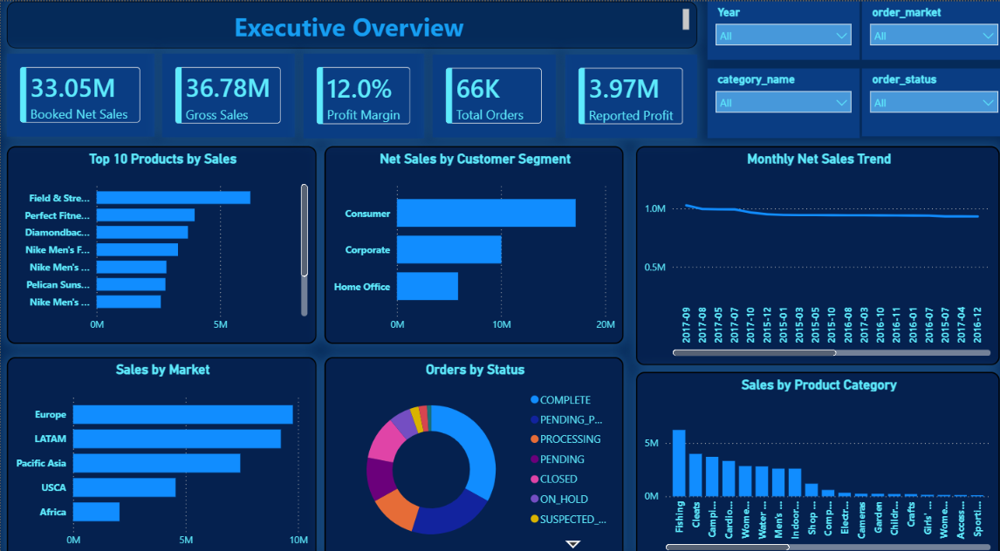
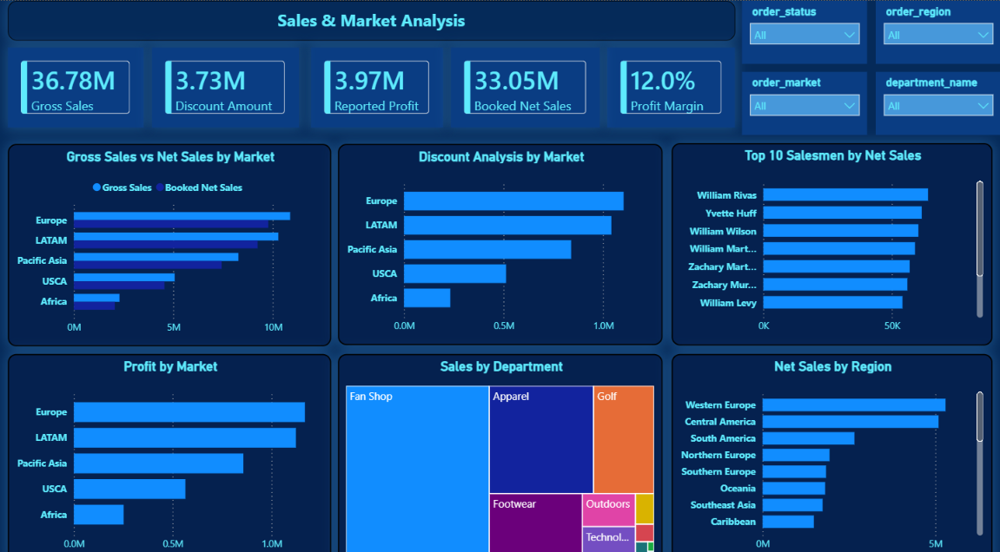
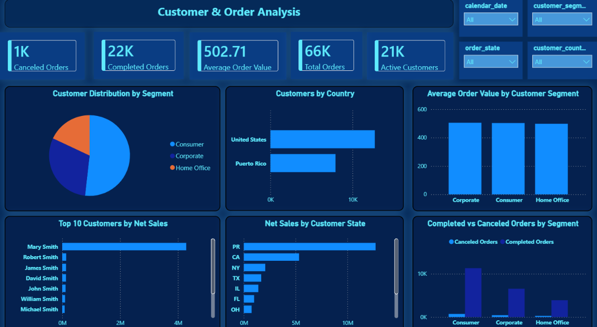

# Power BI Business Intelligence Portfolio

A Business Intelligence portfolio showcasing an end-to-end Supply Chain
Data Warehouse and interactive Power BI dashboards. The project focuses
on transforming operational data into a structured dimensional model and
turning it into actionable business insights.

## Project Overview

The project uses SQL Server for data warehousing and Power BI for data
modeling, DAX calculations, and interactive reporting.

### Data Warehouse Architecture

The data pipeline is organized into three layers:

-   **Bronze Layer:** raw source data.
-   **Silver Layer:** cleaned and prepared data.
-   **Gold Layer:** analytics-ready dimensional model for reporting.

### Gold Layer Data Model

The Power BI semantic model follows a star-schema design:

  -----------------------------------------------------------------------
  Table                               Purpose
  ----------------------------------- -----------------------------------
  `FactOrders`                        Order-level and order-item measures
                                      for business analysis

  `DimCustomers`                      Customer details, location, and
                                      segment

  `DimProducts`                       Product, category, and department
                                      details

  `DimSalesman`                       Salesperson details and commission
                                      information

  `DimDate`                           Calendar attributes for time-based
                                      analysis
  -----------------------------------------------------------------------

## Power BI Dashboards

The report contains four interactive dashboards.

### 1. Executive Overview

A high-level summary of business performance, including:

-   Booked Net Sales
-   Gross Sales
-   Profit Margin
-   Total Orders
-   Reported Profit
-   Top 10 Products by Sales
-   Net Sales by Customer Segment
-   Monthly Net Sales Trend
-   Sales by Market
-   Orders by Status
-   Sales by Product Category



### 2. Sales & Market Analysis

Analyzes sales, discounts, and profitability across markets and regions:

-   Gross Sales vs. Net Sales by Market
-   Discount Analysis by Market
-   Top 10 Salespeople by Net Sales
-   Profit by Market
-   Sales by Department
-   Net Sales by Region



### 3. Customer & Order Analysis

Explores customer distribution, geography, and order behavior:

-   Customer Distribution by Segment
-   Customers by Country
-   Average Order Value by Customer Segment
-   Top 10 Customers by Net Sales
-   Net Sales by Customer State
-   Completed vs. Canceled Orders by Segment



### 4. Shipping & Operational Performance

Evaluates delivery efficiency and shipping operations:

-   Shipped Orders
-   Eligible Shipping Orders
-   Late Orders
-   Late Delivery Rate
-   Average Shipping Days
-   Orders by Delivery Status
-   Late Delivery Rate by Region
-   Actual vs. Scheduled Shipping Days
-   Average Shipping Days by Shipping Mode
-   On-Time vs. Late Orders by Market
-   Net Sales by Shipping Date Trend


## Data Quality & Validation

SQL validation and reconciliation checks were used throughout the
warehouse workflow to review:

-   Row counts across warehouse layers
-   Key uniqueness and duplicate records
-   Missing and invalid values
-   Referential integrity between orders and dimension tables
-   Consistency of loaded data between layers

## Tools & Technologies

-   **Microsoft SQL Server** --- database and data warehouse
-   **T-SQL** --- data preparation, transformation, and validation
-   **Power BI Desktop** --- semantic modeling and dashboard development
-   **DAX** --- measures and business calculations
-   **Dimensional Modeling** --- Bronze, Silver, and Gold architecture
    with a star-schema reporting model

## Repository Contents

``` text
Power-BI-Business-Intelligence-Portfolio/
├── README.md
├── sprint 4.pbix
├── executive-overview.png
├── sales-market-analysis.png
├── customer-order-analysis.png
└── shipping-operational-performance.png
```

## How to Explore the Project

1.  View the dashboard previews directly in this repository.
2.  Download `sprint 4.pbix`.
3.  Open the PBIX file using **Power BI Desktop**.
4.  If prompted, configure the required data source connection for your
    own environment.

## Notes

The screenshots are static previews of the interactive Power BI report.
The PBIX file contains the report/model artifact. Database credentials,
private connection strings, and confidential source data should never be
committed to a public repository.
